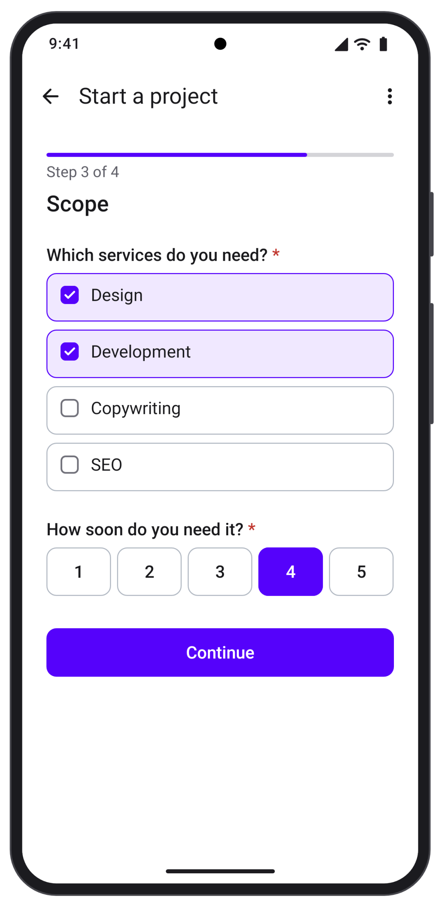
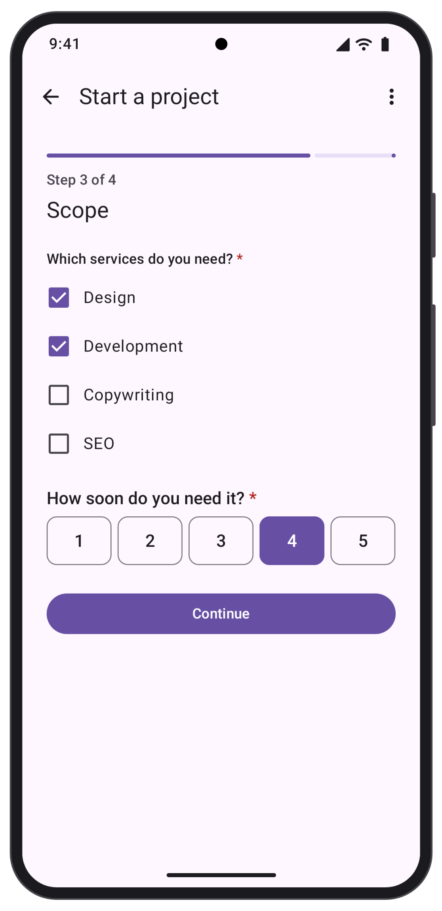
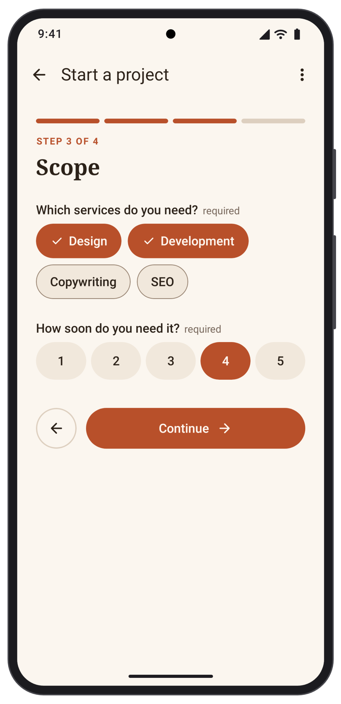

# Compose components

`formhaus-compose` renders a Formhaus JSON definition in Jetpack Compose. Register your own composables per field type, or use one of the built-in sets.

[Android and JVM guide](/guide/android) · [Source](https://github.com/formhaus-dev/formhaus-kotlin) · [Kiln example set](https://github.com/formhaus-dev/formhaus-kotlin/tree/main/demo/src/main/kotlin/dev/formhaus/demo/kiln)

## Install

Releases are published to Maven Central. Add the packages you need:

```kotlin
dependencies {
    implementation("dev.formhaus:formhaus-core:0.8.1")
    implementation("dev.formhaus:formhaus-compose:0.8.1")
}
```

| Package | Contents |
|---|---|
| `formhaus-core` | Engine, validation, `validateSubmission`. Pure Kotlin. |
| `formhaus-compose` | Jetpack Compose renderer. Depends on `formhaus-core`. |
| `formhaus-research` | Option order for `randomize` fields. See [Random option order](/guide/android#random-option-order). |

## Requirements

- JDK 17 or later.
- Android `minSdk` 26 or later. `formhaus-compose` is built with `compileSdk` 37.

## Quick start

Parse a definition and render it. The submit handler returns `SubmitResult.Ok`, or `SubmitResult.Rejected` with errors that the form shows on the fields:

```kotlin
import androidx.compose.runtime.Composable
import dev.formhaus.compose.form.FormhausForm
import dev.formhaus.core.engine.SubmitResult
import dev.formhaus.core.json.JsonValue
import dev.formhaus.core.json.toJsonString
import dev.formhaus.core.model.FormDefinition
import kotlinx.coroutines.Dispatchers
import kotlinx.coroutines.withContext

val definition = FormDefinition(JsonValue.parse(assets.open("signup.json").readBytes()))

@Composable
fun SignupScreen() {
    FormhausForm(definition) { values, _ ->
        val response = withContext(Dispatchers.IO) { api.post("https://example.com/signup", values.toJsonString()) }
        SubmitResult.of(JsonValue.parse(response))
    }
}
```

The submit handler runs on the main thread. `SubmitResult.of(json)` reads the `{ ok, errors, formErrors }` object that a Formhaus endpoint returns. `FormhausForm` also takes `initialValues`, `engineOptions` and `renderer` options. `FormhausFormContent(model)` renders the form without its own scroll container.

`FormhausForm(definition)` keeps its values, step and picked files when the activity is recreated, and restores them after process death. Password values are never saved. Progress over 96 KB is not saved for process death and reports a `snapshot-too-large` warning.

Options with an `image` load the picture over the network, so the app needs the `android.permission.INTERNET` permission.

## Keep a model in a ViewModel

For a form whose state lives outside the composable, create a `FormModel` and pass it to `FormhausForm(model)`. A model you create is yours to close. `close()` stops its work and deletes the files picked in it:

```kotlin
import androidx.lifecycle.ViewModel
import dev.formhaus.compose.model.FormModel

class SignupViewModel : ViewModel() {
    val form = FormModel(definition) { values, _ -> send(values) }

    override fun onCleared() {
        form.close()
    }
}
```

## Save progress

`onSnapshotChange` receives a `FormSnapshot` after the values, the step or the skipped steps change, at most once per frame, and `null` once a submit succeeds. Store `snapshot.toJson()` and pass it back as `restoring` to continue where the respondent left off:

```kotlin
FormhausForm(
    definition,
    restoring = saved?.let(FormSnapshot::fromJson),
    onSnapshotChange = { snapshot -> store(snapshot?.toJson()) },
) { values, _ -> send(values) }
```

`FormModel` takes the same two parameters. To survive process death in a `ViewModel`, keep the JSON in its `SavedStateHandle`:

```kotlin
import androidx.lifecycle.SavedStateHandle
import dev.formhaus.core.engine.FormSnapshot

class SignupViewModel(private val handle: SavedStateHandle) : ViewModel() {
    val form = FormModel(
        definition,
        restoring = handle.get<String>("snapshot")?.let(FormSnapshot::fromJson),
        onSnapshotChange = { snapshot -> handle["snapshot"] = snapshot?.toJson() },
    ) { values, _ -> send(values) }

    override fun onCleared() {
        form.close()
    }
}
```

A snapshot restores the values, the current step, the skipped steps and the option order seed without running validation. A snapshot of another form, another snapshot version, or a step that no longer exists starts the form fresh and reports a `snapshot-mismatch` warning. `restoring` replaces `initialValues`. A snapshot leaves out `password` values, so they are empty after a restore.

## Component sets

The same form in the three sets:

| Formhaus | Material 3 | Your own |
|:---:|:---:|:---:|
|  |  |  |

- `FormComponents.standard` is the Formhaus set and the default. It matches the web renderers and uses the Formhaus design tokens.
- `FormComponents.system` renders Material 3 components and takes its colors from the `MaterialTheme` around it.
- `FormComponents.headless` has no built-in fields, so every type comes from your registrations.

Provide a set with `LocalFormComponents`:

```kotlin
import androidx.compose.runtime.CompositionLocalProvider
import dev.formhaus.compose.form.FormComponents
import dev.formhaus.compose.form.LocalFormComponents

MaterialTheme {
    CompositionLocalProvider(LocalFormComponents provides FormComponents.system) {
        FormhausForm(definition) { _, _ -> SubmitResult.Ok }
    }
}
```

`LocalFormBehavior` takes a `FormBehavior` for the error summary, the remove confirmation, the Back button placement, step scrolling and the title display mode. With `BackPlacement.APP_BAR` the form leaves its Back button out, so your app bar shows Back while `model.actions.showBack` is true and calls `model.back()`.

Switching the components or the theme of a running form keeps its values, step and errors.

## Custom slots

Register a composable per field type on top of a built-in set. Types you leave out keep the built-in views:

```kotlin
val brand = FormComponents.standard
    .field("text") { UnderlineField(it) }
    .field("email") { UnderlineField(it) }

@Composable
fun UnderlineField(context: FieldContext) {
    val requester = remember { FocusRequester() }
    FieldShell(context) {
        BasicTextField(
            value = context.text,
            onValueChange = { context.setValue(JsonValue.String(it)) },
            modifier = Modifier.fillMaxWidth().formhausFocus(context, requester),
        )
    }
}
```

`FieldShell` draws the label, helper text and error, and lets the form scroll to the field. `formhausFocus` moves focus to the first error. `section`, `group`, `groupItem`, `confirmDialog`, `progress` and `actions` replace the containers the same way. The demo app has a [complete custom field](https://github.com/formhaus-dev/formhaus-kotlin/blob/main/demo/src/main/kotlin/dev/formhaus/demo/UnderlineField.kt).

## Theming

`FormhausTheme` holds the [Formhaus design tokens](https://github.com/formhaus-dev/formhaus/tree/main/packages/core/tokens): light and dark palettes, type sizes, spacing, radii, control sizes and motion. `FormhausTheme.standard` is the touch theme.

```kotlin
import androidx.compose.ui.graphics.Color
import androidx.compose.ui.unit.dp
import dev.formhaus.compose.theme.FormhausTheme
import dev.formhaus.compose.theme.Palette

val brand = FormhausTheme.standard.copy(
    light = Palette.light.copy(primary = Color(0xFFB84F29)),
    dark = Palette.dark.copy(primary = Color(0xFFE88259)),
    radii = FormhausTheme.standard.radii.copy(control = 22.dp),
)

FormhausTheme(brand) {
    FormhausForm(definition) { _, _ -> SubmitResult.Ok }
}
```

Custom components read the resolved tokens from `LocalFormhausTokens.current` and style text with `tokens.textStyle(TextRole.body)`. When the system contrast setting is raised, on Android 14 and later, the built-in palettes switch to the `contrast: more` values of the tokens. Set `lightIncreased` and `darkIncreased` to choose those colors yourself.

## Test ids

Set `testIds` to tag the form for Compose UI tests. They are off by default:

```kotlin
FormhausForm(definition, renderer = FormRendererOptions(testIds = TestIds.Automatic)) { _, _ -> SubmitResult.Ok }
```

`TestIds.Automatic` names each element after the definition `id`: `<id>.form`, `<id>.<key>`, `<id>.<key>.<value>`, `<id>.<group>.<index>.<key>`, `<id>.submit`, `<id>.next`, `<id>.back` and `<id>.summary`. The tags are `Modifier.testTag` values:

```kotlin
compose.onNodeWithTag("signup.email").assertExists()
compose.onNodeWithTag("signup.next").performClick()
```

A field tag sits on the field row, which holds the label, the control and the error. `TestIds.Custom { target -> ... }` names the tags yourself from a `TestIdTarget`. Custom field composables read `context.testId` and `context.optionTestId(value)`. See [Testing](/guide/testing) for the web ids.
