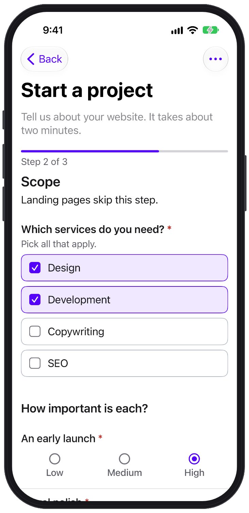
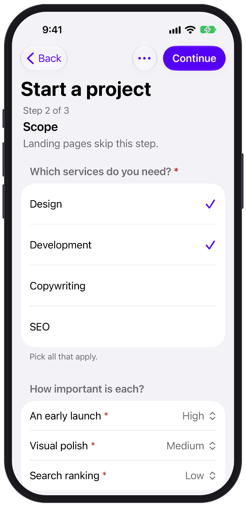
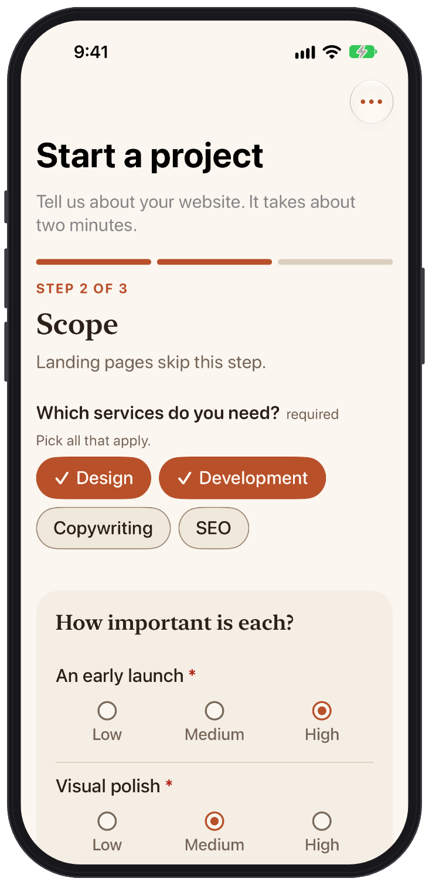

# iOS and macOS

`formhaus-swift` runs the same JSON definition natively on iOS and macOS. `FormhausCore` is the engine and `FormhausUI` is the SwiftUI renderer.

[Source](https://github.com/formhaus-dev/formhaus-swift) · [Demo app](https://github.com/formhaus-dev/formhaus-swift/tree/main/Examples/FormhausDemo) · [Changelog](https://github.com/formhaus-dev/formhaus-swift/blob/main/CHANGELOG.md)

## Install

Add the package with Swift Package Manager:

```swift
.package(url: "https://github.com/formhaus-dev/formhaus-swift.git", from: "0.1.3")
```

Requires Swift 6.2, iOS 17 or macOS 14. There is no JavaScript runtime.

| formhaus-swift | @formhaus/core | Format |
|---|---|---|
| 0.1.3 | 1.0.0 | 1.5 |
| 0.1.0 to 0.1.2 | 0.22.0 | 1.5 |

## Render a form

```swift
import FormhausCore
import FormhausUI
import SwiftUI

struct SignupView: View {
    let definition: FormDefinition

    var body: some View {
        FormhausForm(definition: definition) { values, _ in
            var request = URLRequest(url: endpoint)
            request.httpMethod = "POST"
            request.setValue("application/json", forHTTPHeaderField: "Content-Type")
            request.httpBody = values.jsonData()
            let (data, _) = try await URLSession.shared.data(for: request)
            return SubmitResult(json: try JSONValue(parsing: data))
        }
    }
}
```

The submit handler returns `.ok` or `.rejected`. A rejected submit shows the server errors on the fields, the same way as `@formhaus/react`.

## Choose a look

| Formhaus | iOS system | Your own |
|:---:|:---:|:---:|
|  |  |  |

- The Formhaus set matches the web renderers and uses the Formhaus design tokens.
- `.formhausComponents(.system)` renders a native grouped form, like a Settings screen.
- Register your own SwiftUI views per field type. Types you leave out keep the built-in views. See [SwiftUI components](/guide/integrations/swiftui).

```swift
FormhausForm(definition: definition, onSubmit: send)
    .formhausComponents(.standard.field("text") { MyTextField(context: $0) })
```

## Same rules as the web

The Swift engine passes the shared conformance suite of `@formhaus/core`: every definition check and engine scenario. Validation, conditions, routes, answer recall and the submit payload match the TypeScript packages.

Validate submissions on a Swift server with the same definition:

```swift
let result = validateSubmission(definition, try JSONValue(parsing: body))
```

## Accessibility

The built-in sets label every control for VoiceOver and move VoiceOver focus to the error summary or the invalid field after a failed submit. Text sizes follow Dynamic Type, motion stops with Reduce Motion, tap targets are at least 44 pt, and Increase Contrast switches to the `contrast: more` palette.

## Differences

The Swift package has no drafts and no Cloud client. See the [README](https://github.com/formhaus-dev/formhaus-swift#differences-from-typescript) for the full list of differences.
