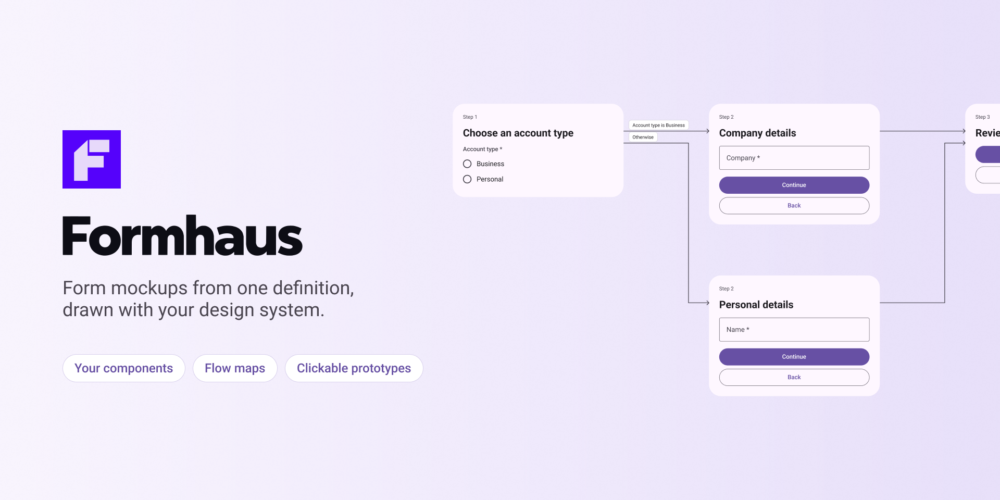

# Figma Community listing

## Name

Formhaus

## Tagline

Form mockups from one definition, drawn with your design system.

## Description

Formhaus draws forms as real component instances: text fields, selects, dates, file uploads, checkboxes, radios, switches and buttons.

- Bind your own components once, or use the built-in Material 3 or iOS-like kit.
- Build a form in the editor, paste a Formhaus JSON definition, or describe it to Claude or an OpenAI model with your own API key.
- Multi-step forms get one frame per step, or one page with sections.
- Forms with routes get a flow map with labelled arrows.
- Forms with separate screens are a clickable prototype: Continue, Back, Skip and branching answers lead to the right step.
- Select a generated form to edit it and update it in place.
- Save your bindings as a design system and share it with a setup code.

The same definition renders in React and Vue with `@formhaus/core`, so the mockup and the shipped form stay in sync.

Docs: https://formhaus.dev/guide/figma.html

## Tags

forms, form builder, design system, components, prototype, flow, wizard, onboarding, survey, quiz, material, ios

## Support

https://github.com/formhaus-dev/formhaus/issues

## Data and network

- The manifest allows `https://api.anthropic.com` and `https://api.openai.com` only. The plugin calls them only after the user adds their own API key under **Describe with AI**. Requests go from the plugin straight to that provider and never to Formhaus.
- API keys are stored in the plugin's client storage on the user's machine, never in the Figma file.
- Form definitions, layouts and bindings are stored in the Figma file as shared plugin data under the `formhaus` namespace.
- Saved design systems are stored in the plugin's client storage on the user's machine.

## Publishing checklist

Full steps: [Publishing to Figma Community](../README.md#publishing-to-figma-community).

1. Enable two-factor authentication on the publishing account. Publish from the Figma desktop app.
2. Build from a clean checkout (`pnpm --filter @formhaus/figma build`) and test in a new file: generate the example forms with a built-in kit, bind a few components, update a form, play the prototype.
3. Open a file, click the Figma logo, then **Plugins → Manage plugins**. Open the menu next to Formhaus and select **Publish**.
4. Click **Generate ID** in the publish dialog. Replace `"id": "formhaus"` in `manifest.json` with the new id, rebuild and commit.
5. **Describe your resource:** paste the name, tagline and description above, and pick a category.
6. **Choose some images:** icon `community/icon.png` (128×128) and thumbnail `community/cover.png`. Figma recommends 1920×1080; the current cover is 1920×960. Add `docs/public/figma/prototype.gif`, `flow-map.png`, `components.png` and `one-page.png` as carousel images.
7. **Data security** (optional): answer from "Data and network" above.
8. **Add the final details:** set the support contact to the issues link and check the network access label.
9. Click **Publish** and wait for the review email.
